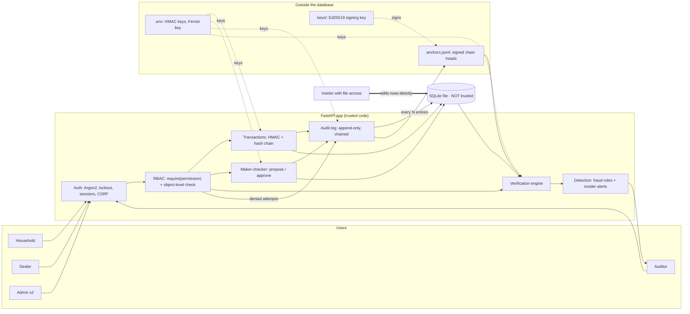
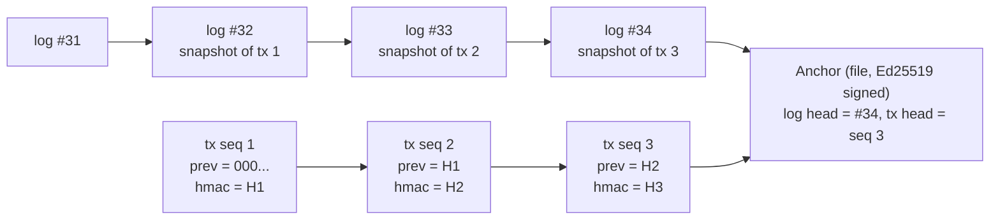

# RationGuard

A **simulated** security-auditing system for a digital ration (public food distribution) portal. College security project.

> All data is fictional. Households, names, addresses and phone numbers are invented. IDs use a made-up format (`HH-000101`); no real ID scheme is imitated.

## The idea in one paragraph

The most dangerous attacker in a ration system is not a hacker on the internet. It is an **insider**: a dealer or admin with a real login who, in the worst case, can open the database file and edit rows directly. RationGuard assumes this will happen. It **does not trust its own database**. Every important record carries a keyed fingerprint (HMAC) whose key is *not* in the database, records are linked in hash chains, and the chain heads are signed and stored outside the database. A verification engine re-checks everything and reports **which record** was touched, **what kind** of tampering it was, and **which field changed from what to what**.

Start with [`THREAT_MODEL.md`](THREAT_MODEL.md) (the STRIDE table everything maps to) and [`CONCEPTS.md`](CONCEPTS.md) (plain-language study notes for the viva).

## Setup

Needs Python 3.11 or newer.

```bash
python -m venv .venv
```

```bash
source .venv/bin/activate
```

```bash
pip install -r requirements.txt
```

```bash
python scripts/setup_keys.py
```

The last command creates `.env` and `keys/` with **fresh random keys on your machine** and prints the demo password. Both are git-ignored. No secret is in the repository.

## Run the demo

```bash
./demo.sh
```

This tells the full story in the terminal:

1. Creates a fresh database with fictional households.
2. A dealer records three distributions through the real app (login, CSRF, permission checks).
3. `verify` runs: **all green**.
4. The attack runs: an insider opens the SQLite file and changes 5 kg of rice to 25 kg.
5. `verify` runs again: **red**, naming `transaction seq 1`, kind `MODIFIED`, `quantity_kg: was 5 -> now 25`.
6. Alerts and a before/after summary are printed.

Other stories:

```bash
./demo.sh delete_transaction
```

```bash
./demo.sh all
```

| Attack script (`attacks/`) | What the insider does | What stops or catches it |
|---|---|---|
| `tamper_transaction.py` | Edits 5 kg to 25 kg in the DB file | HMAC mismatch; field diff from audit snapshot |
| `delete_transaction.py` | Deletes a transaction row | Gap in chain; audit snapshot shows what was deleted |
| `tamper_and_recompute_hash.py` | Edits the row and recomputes a SHA-256 | Fails: the real value needs the secret key |
| `tamper_audit_log.py` | Drops the trigger, edits a log row | Trigger blocks the first try; chain catches the second |
| `idor_attempt.py` | Household asks for another household's history | 403, logged; same answer for IDs that do not exist |
| `self_approve_change.py` | Admin approves own request, then doctors the request row | Two-person rule (403), then request HMAC (409) |
| `reorder_transactions.py` *(bonus)* | Swaps two sequence numbers | Sequence number is inside the HMAC |
| `truncate_log_tail.py` *(bonus)* | Removes the newest transaction and log entries; chains stay valid | Signed anchor remembers the longer chain |
| `insert_ghost_transaction.py` *(bonus)* | Inserts a fake transaction | No valid HMAC, no audit entry |

The direct-edit scripts use only Python's built-in `sqlite3`. They never load the keys, which is exactly the insider's position.

## Use the web app

```bash
python -m rationguard seed
```

```bash
python -m rationguard serve
```

Open http://127.0.0.1:8000. The password for every demo user is the one printed by `setup_keys.py` (also in `.env` as `RG_SEED_PASSWORD`).

| Username | Role | Can do |
|---|---|---|
| `hh000101` … `hh000112` | household | See only its own history and record |
| `dealer1`, `dealer2`, `dealer3` | dealer | Record transactions for households of their own shop |
| `admin1`, `admin2` | admin | Propose and approve changes to beneficiary data (never their own) |
| `auditor1` | auditor | Read-only: verification, alerts, audit log |

Other commands:

```bash
python -m rationguard verify
```

```bash
python -m rationguard alerts
```

```bash
python -m rationguard anchor
```

`verify` exits with code 0 when everything is intact and 1 when tampering is found.

## Tests

```bash
python -m pytest
```

184 tests. Each test gets its own copy of a seeded database and throw-away keys. Highlights:

- `tests/test_attacks.py` – every attack script has a test proving it is detected or blocked, including the exact field diff.
- `tests/test_rbac.py` – every role against every route (60 cases), plus a test that **fails if any route has no permission check**.
- `tests/test_auth.py` – Argon2, lockout, rate limit, cookie flags, CSRF, session fixation.
- `tests/test_hygiene.py` – nothing secret is tracked by git; the app refuses placeholder keys.

## Hosted demo on Vercel (optional, limited)

The project can be put online on Vercel so people can click around, but it is a **reduced** version. Vercel runs the app as a short-lived serverless function with no permanent disk, and this project is built around a database *file*.

| On your laptop | On Vercel |
|---|---|
| Data stays until you delete it | Database lives in `/tmp` and is re-seeded whenever a fresh copy of the function starts |
| Attack scripts edit the file | No access to the file, so the insider-attack demo cannot run |
| One process | Vercel may run several copies, each with its own database, so you can occasionally be logged out or see different data |
| Rate limit per visitor address | All visitors share Vercel's proxy address, so the login rate limit is shared |

Steps:

1. Generate a separate set of secrets for the hosted copy:

   ```bash
   python scripts/vercel_env.py
   ```

   This writes `.env.vercel` (git-ignored) and prints the login password for the hosted demo users.
2. On vercel.com choose **Add New → Project**, import this GitHub repository, and leave the build settings at their defaults.
3. Open **Environment Variables**, click **Import .env** and choose `.env.vercel`.
4. Click **Deploy**.

`api/index.py` is the entry point, `vercel.json` sends every URL to it, and `.vercelignore` keeps tests, attack scripts and local secrets out of the upload. For the viva, use the local demo.

## Architecture



How the two chains and the anchor fit together:



### Where things are

| Path | What it is |
|---|---|
| `rationguard/crypto.py` | Canonical serialisation, HMAC, Fernet, Ed25519, masking |
| `rationguard/integrity.py` | Which fields each record's HMAC covers |
| `rationguard/security.py` | Passwords, login, lockout, sessions, CSRF |
| `rationguard/rbac.py` | Permission table and the single `require()` check |
| `rationguard/transactions.py` | Creating transactions, idempotency, quota rule |
| `rationguard/households.py` | Maker-checker |
| `rationguard/audit.py` | Audit log and anchors |
| `rationguard/verify.py` | Verification engine |
| `rationguard/detection.py` | Fraud rules and insider alerts |
| `rationguard/app.py` | Routes |
| `api/index.py`, `vercel.json` | Entry point for the optional hosted demo |
| `attacks/` | Attack simulator |
| `tests/` | Security tests |

## Design choices and their trade-offs

Where a choice could go two ways, the more secure one was taken. The cost is noted so it can be defended in a viva.

| Choice | Why | Cost |
|---|---|---|
| The audit chain uses **HMAC**, not a plain hash | An insider cannot recompute links after an edit | The verifier needs the key (anchors need only the public key) |
| **Three separate HMAC keys** (transactions, audit log, other records) | Leaking one key does not break the others | More keys to manage |
| **Alerts are not stored**; they are recomputed from the audit log | A stored alert is a row an insider could delete | Recomputing costs time on a large log |
| **Server-side sessions** (random token, only its hash stored) instead of JWT | Logout and tamper-kill really end the session; DB thieves cannot reuse tokens | One DB lookup per request |
| **Account lockout** after 5 failures | Stops password guessing | Someone can lock a victim out for 15 minutes on purpose. Mitigated by per-IP rate limit and an alert |
| **Over-quota is blocked**; duplicates are only flagged | Over-quota is never legitimate; collecting a quota in two visits is | Flags need a human to review |
| Entitlement **month comes from the server clock**, not the form | No back-dating into a month with spare quota | Late entry for last month is impossible |
| Issue is **refused if the household's HMAC fails** | A quota raised by a DB edit cannot be cashed in | One tampered row blocks that household until it is fixed |
| Same **403 for "not yours" and "does not exist"** (household and dealer) | Sequential IDs cannot be enumerated | Slightly less helpful error |
| **Whole kilograms** and fixed-format UTC timestamps | One record has exactly one byte representation, so HMACs are stable | No 2.5 kg issues |
| **One writer at a time** (`BEGIN IMMEDIATE`) | Two transactions can never take the same chain position | Lower throughput; fine for SQLite |
| **No web page for creating users or changing roles** (CLI only, logged) | Smaller attack surface | Less convenient |
| **Admin cannot view distribution history; auditor cannot view names** | Each role gets the minimum it needs | Investigations need two people |
| Triggers on **transactions** as well as the audit log | Casual edits fail loudly | An owner of the file can drop them (verification reports that) |
| Verification **never repairs** anything | Evidence stays as the attacker left it | Recovery is manual |
| Auditor's verify button writes one `VERIFICATION_RUN` log entry | "Who checked, and when" is itself evidence | The auditor is read-only for business data, not for the log |
| Client IP is the socket address; `X-Forwarded-For` is ignored | That header can be forged | Behind a proxy all users would share one IP |

## Limitations (honest list)

1. **The keys live on the same machine as the data.** The whole design assumes the insider can edit the database but cannot read `.env` or `keys/`. Anyone with full control of the server can read them and forge valid HMACs. A real system would keep keys in an HSM or a cloud KMS so the app can *ask for* an HMAC but never *see* the key.
2. **The anchor file is on the same disk.** An insider who rolls back the database **and** the anchor file to the same earlier moment leaves no trace. Real systems send anchors to external write-once (WORM) storage, a separate organisation, or a public transparency log.
3. **There is a gap after the last anchor.** Anchors are written every `RG_ANCHOR_EVERY` audit entries (default 5). Entries newer than the last anchor can be cut off without detection. Setting it to 1 closes the gap at the cost of one signature per entry.
4. **Tampering is detected, not prevented.** Nothing inside a file can stop its owner from editing it. Detection also only happens when someone runs verification.
5. **Original values come from the audit log.** If the attacker damages both a record and its log entry, both are reported, but the original value can no longer be shown.
6. **Distribution history is only partly confidential at rest.** Names, addresses and phone numbers are encrypted. Transaction rows and household codes are not (the app must query and sum them), so a database thief sees pseudonymous history. Full database encryption (for example SQLCipher) would be the fix.
7. **One Fernet key, no rotation.** Changing it means re-encrypting every row.
8. **The demo runs over plain HTTP on localhost.** In production it needs TLS and `RG_COOKIE_SECURE=true`.
9. **No multi-factor authentication.** A stolen password is enough to log in.
10. **The rate limiter is in memory.** It resets on restart and is not shared between processes.
11. **The server clock is trusted.** An insider with OS access could change it to dodge the off-hours rule or shift the entitlement month.
12. **The code itself is trusted.** Someone who can modify the Python files can disable the checks. Real systems use code signing, reviews and a separate verification service.
13. **Fraud rules are simple fixed thresholds.** They produce hints for a human, with false positives and false negatives.
14. **Software cannot see the physical world.** If a dealer records an honest-looking transaction for grain that was never handed over, no hash can know. Real systems add biometric or OTP confirmation by the household.
15. **Masking is display-only.** Lists show `HH-***101`, but links still carry the full code in the URL.
